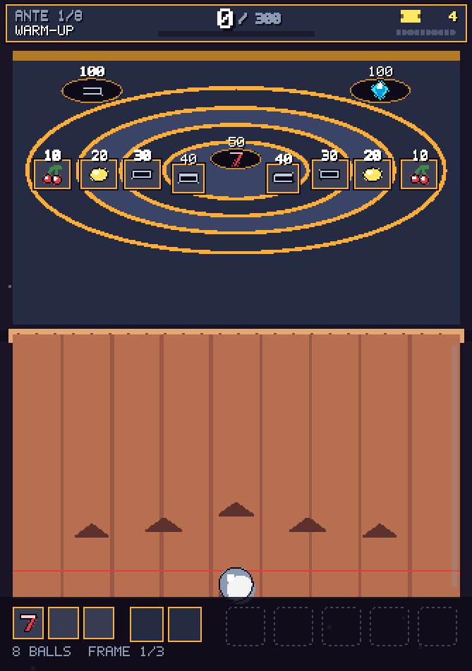
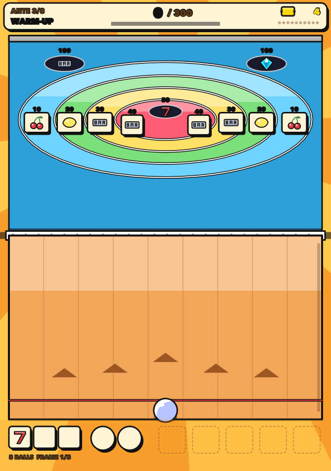
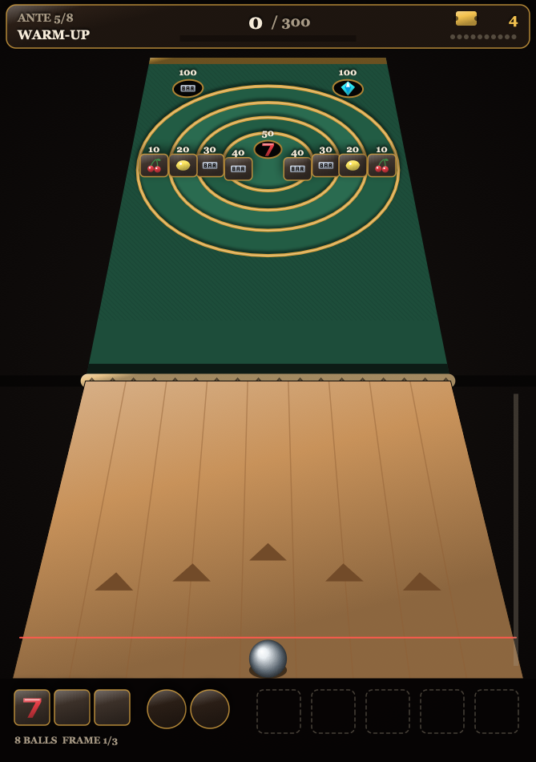
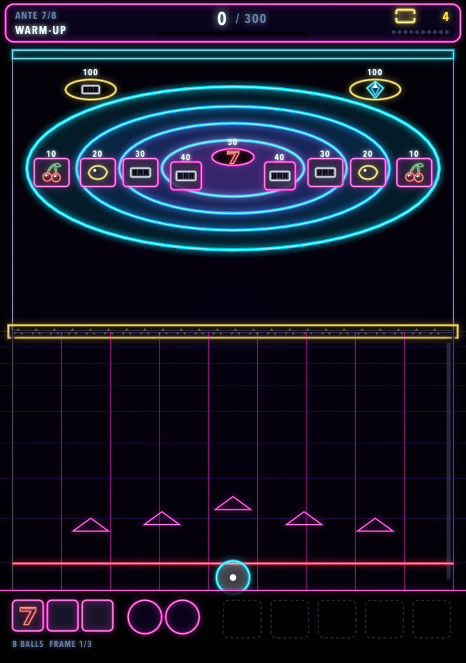
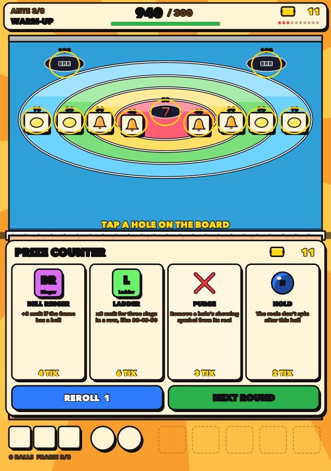
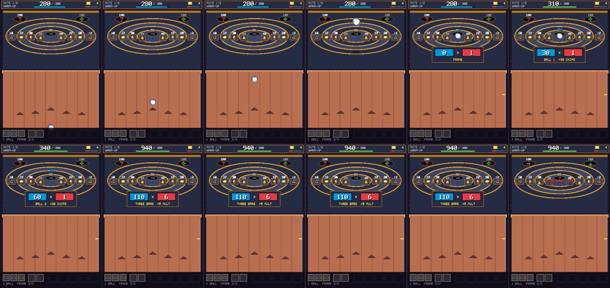

# Design

## The pitch in one throw

The iPhone Duo's inner display folds across the middle. The game puts the lane
below the fold and the target board above it, so the ball crosses the hinge
when it leaves the ramp. Flick up the lane. The ball rolls, climbs the ridge,
flies, and drops into a ring. The hole it lands in shows a symbol on a little
reel. Three balls make a payline. The line pays mult, the holes pay chips, and
your charms bend both.

## Where the mechanics come from

### Skee-ball

Kept: the alley, the hump, concentric rings worth 10 to 50, the two 100 pockets
in the top corners, nine balls a game, tickets as the currency.

Changed: the 100 pockets only take a ball on a clean first flight (no wall
bounce first), because in the physics the walls funnel balls into the corners.
See [PHYSICS.md](PHYSICS.md).

### Slot-machine roguelikes

Research (Luck be a Landlord, CloverPit) pointed at four ideas, and each is used:

| Idea | In those games | Here |
|------|----------------|------|
| A deadline that escalates | rent (LBaL), debt every three rounds (CloverPit) | a target score per round that grows every ante |
| Building your reels | add symbols to the reel pool (LBaL) | stamps add a symbol to one hole's reel; purges remove the one showing |
| Anticipation on every pull | reels spin and stop | every hole's reel spins after every ball; you watch where they land, then aim |
| A meter that turns losses into hope | progressive / bonus meters | heat: rattles and gutters fill it; full heat makes the next frame a FEVER frame at x2 |

The common complaint about Luck be a Landlord is dilution: adding symbols makes
the one you want less likely to come up. Here the reels are still random, but
you choose which reel to hit. Seven reels are showing something at all times,
and skill picks the stop. A stamp is never wasted because you can aim for it.

The board teaches the slot vocabulary without a tutorial. 10 shows cherries,
50 shows sevens, the pockets show diamonds, and a gutter is a blank.

### Balatro

| Balatro | Here |
|---------|------|
| small blind, big blind, boss blind | Warm-up, Feature Game, Boss Machine |
| 8 antes | 8 antes |
| chips x mult, scored step by step | the same, and the app counts it up step by step in blue and red boxes |
| Jokers, applied left to right | Charms, 5 slots, applied left to right (order matters: +4 then x3 is not x3 then +4) |
| Tarot / planet cards | specialty balls (consumables) and gilds (permanent chips on a hole) |
| interest on held money | 1 ticket per 5 held, up to 5 |
| boss shown in advance | the ante's boss machine is drawn at ante start and shown |

## A round

- 3 frames of 3 balls (9 balls, as on a real alley). The Extra Ball charm adds a
  frame; Short Hand removes one.
- Each ball scores its hole's chips (face value plus gild) and takes the symbol
  its hole is showing.
- After the third ball the frame is scored:
  1. base chips 0, mult 1
  2. each ball's chips; each cherry also pays a flat +10
  3. the payline: pair or three of a kind, with clover wild
  4. charms, left to right
  5. FEVER x2 if the heat meter was full going in
- The round ends after the last frame. Reach the target, or the run is over.

### Payline values

| Symbol | Home hole | Pair mult | Triple mult |
|--------|-----------|-----------|-------------|
| cherry | 10 | +1 | +3 |
| lemon | 20 | +1 | +3 |
| bell | 30 | +2 | +4 |
| bar | 40 | +2 | +5 |
| clover (wild) | pockets | +2 | +5 |
| seven | 50 | +3 | +10 (JACKPOT) |
| diamond | pockets | +4 | +12 (JACKPOT) |

Each reel is five symbols, mostly its home symbol, with a few neighbours. For
example the 50 reel is `seven, bar, seven, bell, cherry`.

## The economy

Tickets. A cleared round pays 3, 4 or 5 by round kind, plus 1 per 50% of
overkill above the target (up to 5), plus interest. Ticket Muncher pays per 50
and 100.

The prize counter offers 2 charms, 1 board edit (stamp, gild or purge) and 1
specialty ball. Rerolls cost 1, then 2, then 3. Charms sell for half.

## Charms

| Charm | Cost | Effect |
|-------|------|--------|
| Lucky Penny | 3 | +2 mult per cherry |
| Gutter Rat | 3 | gutter balls are worth 25 chips |
| Heavy Hand | 4 | +40 chips per 50 |
| Near Miss | 4 | +15 chips per lip rattle |
| Mult Ball | 4 | +4 mult |
| Bell Ringer | 4 | +3 mult if the frame has a bell |
| Hot Streak | 5 | +1 mult per scoring ball in a row this round |
| Ticket Muncher | 5 | +1 ticket per 50 or 100 |
| Hinge Whisperer | 5 | +3 mult per ball thrown with the hinge at least half folded |
| Seven Seas | 5 | +1 mult per 7, then x2 on a pair or better of 7s |
| Even Steven | 6 | x2 mult if all three balls hit the same hole |
| Ladder | 6 | x3 mult for three rings in a row (30-40-50 etc.) |
| Corner Office | 6 | x1.5 mult per 100 pocket |
| Glass Cannon | 7 | x3 mult, but a gutter ball zeroes the frame |
| Extra Ball | 8 | +1 frame every round |

Near Miss turns the slot machine's most manipulative trick into an honest
reward. A rattle on a lip is a real near miss, and with this charm it pays.

## Specialty balls

Golden (chips x3), Feather (ignores ring lips), Magnet (bigger holes), Wild
(symbol becomes clover), Hold (the reels don't spin after this ball, so the
symbol you saw stays put for the next throw). Arm one by tapping it; it
applies to the next throw.

## Boss machines

| Boss | Rule |
|------|------|
| Tall Lips | lips 60% taller and wider: more rattles |
| Slick Lane | frictionless lane, hinge carries 4% more speed: the 50 moves from power 0.63 to 0.56 |
| Crosswind | constant sideways push on the board: aim into it |
| The Miser | the 50 pays no chips |
| Short Hand | one frame fewer |
| Tight Pockets | 50 hole and pockets shrink |
| The House | pairs pay nothing; only three of a kind counts |

## The edge: harder but never impossible

Physics is fully repeatable. The same flick always does the same thing. The
difficulty comes from narrower targets, not from randomness. Per ante, from 1
to 8:

- the 50 hole shrinks from 3.0 cm to 2.5 cm radius
- pockets shrink from 3.6 cm to 3.0 cm
- the lip band (how close to a ring wall counts as landing on the lip) widens
  from 0.6 to 0.85 ball radii
- holes catch only slower balls (capture speed 1.2 to 0.9 m/s)

`DifficultyTests.lastAnteIsStillPlayable` runs every boss at ante 8. It requires
that some aim leaves at least 1.5% of the power range landing a 50. If a tuning
change breaks that, the suite fails.

## The hinge

The fold is an input. `UIHingeInteraction` reports the hinge angle. Flat open
means a 45° ramp; folded to a right angle means 65°. Folding lofts the ball:
it flies higher, lands shorter and drops more steeply. Hinge Whisperer rewards
playing folded.

A closed hinge means the player is on the outer display, so it counts as no
fold. Treating closed as maximum fold was a real bug, found in the simulator.

## Art eras

No emoji, no image assets. Every symbol is vector geometry and every pixel-era
letter comes from a 5×7 bitmap font in code. The style changes every two
antes, with an iris wipe out of the hinge:

| Antes | Era | How it's drawn |
|-------|-----|----------------|
| 1-2 | 8-BIT ARCADE | whole scene at half resolution, no antialiasing, nearest-neighbour upscale, small dusty palette |
| 3-4 | CARTOON ALLEY | flat colours, one hard highlight band, thick black ink, sunburst |
| 5-6 | THE REAL DEAL | real perspective on lane and board, maple, felt, brass lips, chrome ball |
| 7-8 | VECTOR NIGHT | black glass, glowing strokes, perspective grid |

| pixel | cel | depth | neon |
|-------|-----|-------|------|
|  |  |  |  |

The prize counter sits on the lane half, so the board stays visible for stamp
targeting:

One throw, from `skee film`: release, over the hinge, into the 50, then the
tally counting chips × mult:

## What makes it fun (the bets)

- **Every ball is a decision.** The reels spin after each throw, so the best
  target keeps changing. Take the safe 40 for a bar pair, or go for the pocket
  showing a seven?
- **The jackpot is earned.** Triple sevens means three precise shots while the
  reels cooperate. The bot data says regular players see about 3.6 per run.
- **Misses feed something.** Rattles and gutters fill the fever meter.
- **The machine changes under you.** Bosses move the sweet spot; the art era
  changes the room.
- **The counting is the payoff.** Chips and mult tick up step by step, and
  each charm's contribution is named as it lands.
